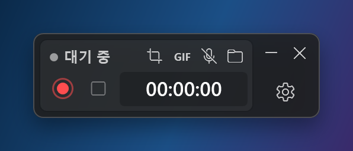
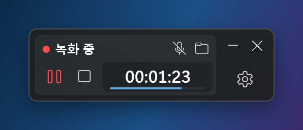
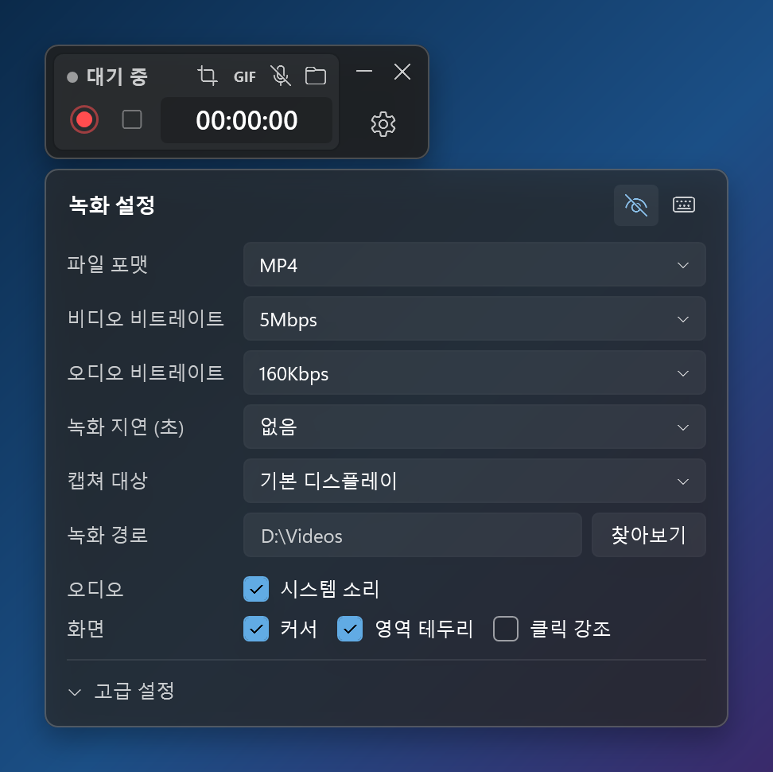
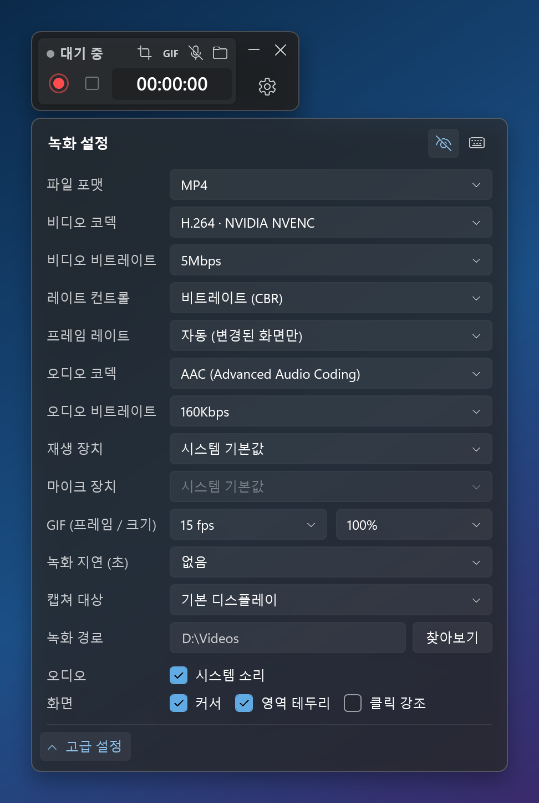
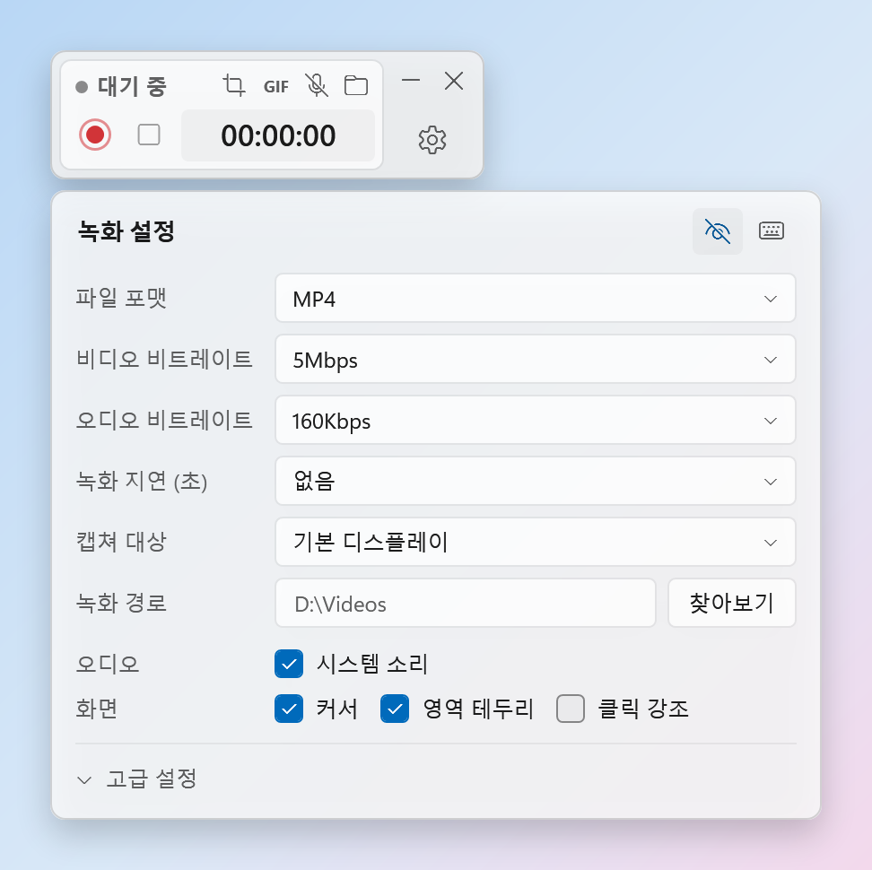

🌏 [English](./README.md)


# Screen Recorder

<p>
  
  
  
  
</p>

작고 빠른 Windows용 화면 녹화 프로그램입니다. 작은 도구 모음 하나로, 녹화 버튼을 누르고
정지 버튼을 누르면 MP4 — 또는 GIF — 가 만들어집니다.

 

| 설정 | 고급 설정 |
|---|---|
|  |  |

Windows의 밝게 / 어둡게 모드(및 고대비)를 따르며, 지원되는 환경에서는 Windows 11의 재질
효과를 사용합니다.



## 📃 사용법
- **녹화**: 동그란 버튼으로 시작하고 네모 버튼으로 정지합니다. 파일은 동영상 폴더(변경 가능)에 저장되며, 알림을 눌러 바로 열 수 있습니다.
- **일시정지 / 다시 시작**: 녹화 중에는 녹화 버튼이 일시정지 버튼이 됩니다. 일시정지한 시간은 파일에 들어가지 않습니다.
- **영역 녹화**: 자르기 버튼 — 또는 어디서나 `Alt`+`Shift`+`R` — 을 누르면 영역을 드래그하거나, 창을 클릭하거나, 디스플레이를 골라 바로 녹화를 시작합니다. 같은 단축키로 정지합니다.
- **창을 이름으로 골라 녹화**: 도구 모음(또는 트레이 아이콘)을 우클릭 → *창 녹화*에 열려 있는 창 목록이 나옵니다. 하나를 고르면 그 창이 녹화되며, 다른 창에 가려져 있어도 됩니다.
- **GIF 녹화**: GIF 버튼 — 또는 어디서나 `Alt`+`Shift`+`G` — 을 누르면 같은 방식으로 움직이는 GIF를 저장합니다.
- **마이크**: 도구 모음의 마이크 버튼으로 내 목소리 녹음을 켜고 끕니다. 녹화 중에는 시간 아래의 얇은 막대가 파일에 들어가는 소리의 크기를 보여 줍니다.
- **숨겨 두기**: 최소화 버튼을 누르면 도구 모음이 알림 영역(트레이)으로 숨습니다. 단축키는 그대로 동작하므로 `Alt`+`Shift`+`R`만 누르면 바로 녹화할 수 있고, 트레이 아이콘을 클릭하거나 프로그램을 다시 실행하면 도구 모음이 돌아옵니다. 녹화 중에는 아이콘에 빨간 점이 표시됩니다.
- **설정**: 톱니바퀴 버튼. *고급 설정*을 펼치면 코덱, 비트레이트, 프레임 레이트, 오디오 장치, GIF 옵션이 나타납니다.
- **단축키**: 설정의 키보드 버튼(또는 우클릭 메뉴)에서 시작, 일시정지, 정지, 영역 녹화, GIF 녹화의 전역 단축키를 지정할 수 있습니다.

## 🎨 기능

**녹화 대상**
- 디스플레이 하나, **모든 디스플레이 한꺼번에**, 드래그한 영역(**여러 모니터에 걸쳐도 됩니다**), 또는 **창** — 창은 창 자체로 녹화되므로 옮기거나 다른 창에 가려져도 화면에 그대로 담깁니다. 화면에서 클릭해 고르거나 열린 창 목록에서 고를 수 있습니다.
- 소리만 필요할 때는 **오디오만**(M4A 또는 MP3) 녹음할 수 있습니다.
- 시스템 소리와 마이크를 함께 녹음합니다. 두 장치 모두 선택할 수 있고, 기본 장치가 바뀌면 따라갑니다. 레벨 미터로 녹음되는 소리를 확인할 수 있습니다.
- 녹화 프로그램 자신의 창은 녹화에 포함되지 않습니다. 마우스 커서 포함 여부를 선택할 수 있습니다.
- **클릭 강조**(선택): 마우스를 클릭한 위치에 링이 표시됩니다.
- 녹화 중인 영역의 테두리 표시(선택), 시작 전 카운트다운(3 / 5 / 10초).

**비디오**
- MP4, MKV, MOV, MPEG-TS, AVI / H.264, H.265(HEVC), AV1.
- **NVIDIA NVENC**, **Intel Quick Sync**, **AMD AMF** 하드웨어 인코딩. PC에서 동작하는 하드웨어 인코더가 모두 표시되며, 없으면 자동으로 소프트웨어 인코딩을 사용합니다.
- **자동 프레임 레이트**(기본값): 실제로 바뀐 프레임만, 디스플레이 주사율 범위 안에서 기록합니다. 멈춰 있는 화면은 용량을 거의 쓰지 않고, 움직임은 부드럽게 남습니다. 고정 프레임 레이트(15 ~ 144 fps, CFR)는 고급 설정에서 고를 수 있습니다.
- 비트레이트 또는 고정 품질 방식의 레이트 컨트롤.
- NVIDIA 그래픽 카드에서는 캡처한 프레임이 **GPU를 벗어나지 않고** 인코더로 전달됩니다.
- 소리와 화면이 하나의 시계를 공유하고 오디오 장치 간 클록 차이를 보정하므로, 긴 녹화에서도 싱크가 유지됩니다.
- **중단에 안전한 MP4**: 녹화하는 동안 조각 단위로 기록하므로, 프로그램이 죽거나 전원이 나가도 녹화본을 잃지 않습니다.

**GIF**
- 영역을 고르면 바로 녹화됩니다 — 편집기도 타임라인도 없습니다. 프레임마다 바뀐 부분만 저장해 파일이 작습니다.
- 프레임 레이트(10 ~ 30 fps)와 크기(100 / 75 / 50 %)는 고급 설정에서 바꿉니다.

**프로그램**
- 한국어와 영어.
- 설정은 평범한 JSON 파일(`%APPDATA%\ScreenRecorder\settings.json`)입니다. 이전 버전의 설정은 자동으로 가져옵니다.
- 포터블 빌드: 압축을 풀어 실행하면 되고, 설정은 프로그램 옆 `UserData` 폴더에 저장됩니다.

## 💡 시스템 요구사항
- Windows 10 64비트 버전 1903 이상 (자기 창을 녹화에서 제외하려면 버전 2004 이상). Mica / Acrylic 효과는 Windows 11 22H2 이상.
- DirectX 11을 지원하는 그래픽 카드.
  - **NVENC**: NVIDIA 드라이버 **570.0** 이상 — H.264는 GTX 750 / GTX 900 시리즈 이상, HEVC는 GTX 950 / 960 이상, AV1은 RTX 40 시리즈 이상의 그래픽 카드가 해당됩니다. (GTX 600 / 700 시리즈는 그 버전 이전에 드라이버 지원이 끝났습니다. 이런 카드나 오래된 드라이버에서는 소프트웨어 인코딩을 사용합니다.)
  - **Quick Sync / AMF**: 최신 Intel / AMD 그래픽 드라이버. (하드웨어 인코딩은 NVIDIA에서 개발·검증되었습니다. Intel, AMD 환경의 사용 결과를 알려 주시면 큰 도움이 됩니다.)
  - 사용할 수 있는 하드웨어 인코더가 없으면 자동으로 소프트웨어 인코딩을 사용합니다.
- 설치 프로그램에 필요한 것이 모두 들어 있습니다 — **별도의 .NET 런타임 설치가 필요 없습니다**.

## 📥 설치
- 설치 프로그램 또는 포터블 zip: [Releases](https://github.com/akon47/ScreenRecorder/releases)
- winget: `winget install kimhwan.ScreenRecorder`

## 📚 참고
- [Softpedia review of v1.0.4](https://www.softpedia.com/get/Multimedia/Video/Video-Recording/ScreenRecorder-K.shtml)
- [ilovefreesoftware review](https://www.ilovefreesoftware.com/08/windows-10/free-screen-recorder-for-windows-select-desired-gpu-for-recording.html)

## 👨‍💻 빌드

- .NET 9 SDK (`win-x64`)
- Windows 10 64비트 이상

FFmpeg 공유 라이브러리는 저장소에 포함되어 있지 않습니다. 빌드·실행 전에 FFmpeg 8.x 공유 DLL
**5개**(`avcodec-62`, `avformat-62`, `avutil-60`, `swresample-6`, `swscale-9`)를
`Externals/ffmpeg/win-x64/`에 넣어 주세요 (`Externals/ffmpeg/README.md` 참고. 예:
[gyan.dev](https://github.com/GyanD/codexffmpeg/releases)의 `ffmpeg-8.1-full_build-shared` 빌드).

```pwsh
# 빌드 및 실행
dotnet run --project ScreenRecorder/ScreenRecorder.csproj

# 테스트 실행 (엔진 + 앱). "Hardware" 테스트는 GPU와 데스크톱 세션이 필요합니다.
dotnet test ScreenRecorder.Tests/ScreenRecorder.Tests.csproj
dotnet test ScreenRecorder.App.Tests/ScreenRecorder.App.Tests.csproj

# 설치 프로그램과 포터블 zip 빌드 — NSIS(makensis) 필요
Installers\build_setup.bat 3.0.0
```

| 프로젝트 | 설명 |
|---|---|
| `ScreenRecorder` | 앱 (WPF). |
| `ScreenRecorder.Engine` | 캡처, 오디오, 인코딩, 먹싱 — UI 없음. |
| `ScreenRecorder.Tests` / `ScreenRecorder.App.Tests` | 엔진과 앱의 자동화 테스트. |
| `ScreenRecorder.EncoderHarness` | 엔진을 직접 돌려 보는 콘솔 도구. |

## 📦 서드 파티 라이브러리
- FFmpeg: https://www.ffmpeg.org/ ([FFmpeg.AutoGen](https://github.com/Ruslan-B/FFmpeg.AutoGen) 사용)
- Vortice.Windows (Direct3D 11 / DXGI): https://github.com/amerkoleci/Vortice.Windows
- NAudio (WASAPI): https://github.com/naudio/NAudio
- CommunityToolkit.Mvvm: https://github.com/CommunityToolkit/dotnet
- Microsoft.Extensions.DependencyInjection: https://github.com/dotnet/runtime

## 💁 기능 요청
- 원하는 기능이 있다면 [issues](https://github.com/akon47/ScreenRecorder/issues)에 **Feature Request** 라벨로 요청해 주세요.

## 🎆 기여
- 이 프로젝트는 오픈 소스 프로젝트입니다. 누구나 어떤 방식으로든 기여할 수 있습니다.

## 🐞 버그 신고
- 버그를 발견하면 GitHub [issues](https://github.com/akon47/ScreenRecorder/issues)에 올려 주세요.
