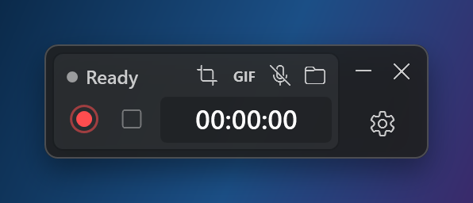
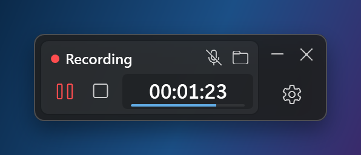
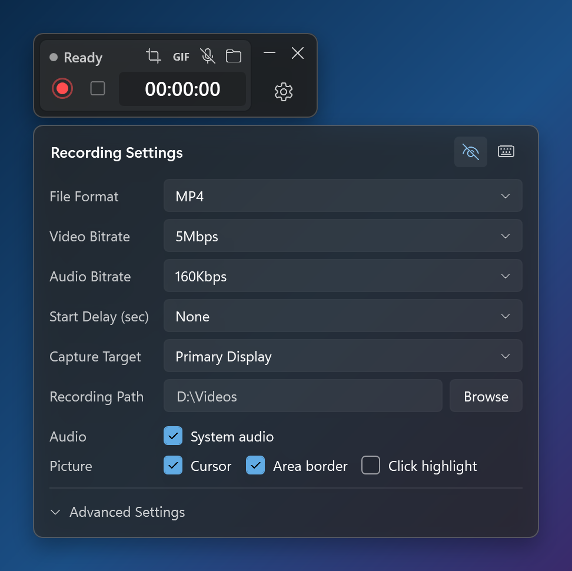
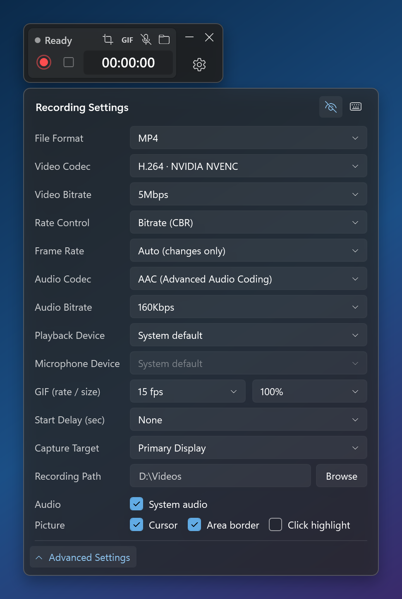
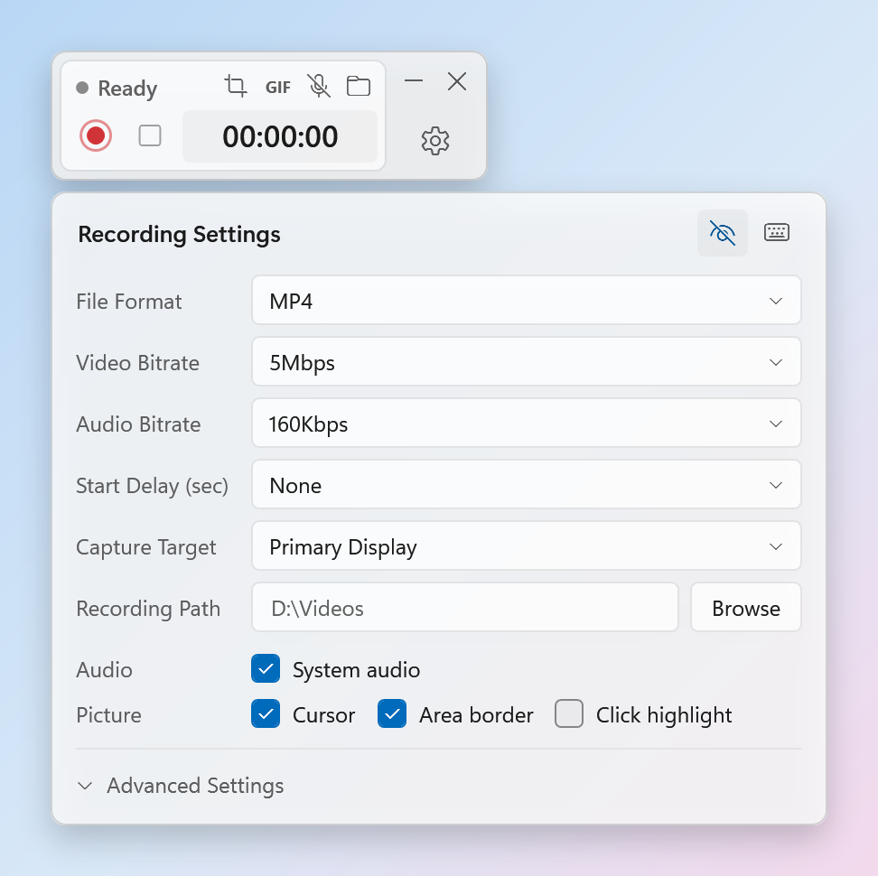

🌏 [한국어](./README-ko.md)


# Screen Recorder

<p>
  
  
  
  
</p>

A small, fast screen recorder for Windows. One compact toolbar: press record, press stop,
get an MP4 — or a GIF.

 

| Settings | Advanced settings |
|---|---|
|  |  |

The app follows the Windows light / dark mode (and high contrast) and uses the Windows 11
materials where available.



## 📃 Usage
- **Record**: the round button starts, the square button stops. The file is saved to your Videos folder (changeable) and a notification lets you open it.
- **Pause / resume**: while recording, the record button becomes pause. Paused time is not in the file.
- **Record an area**: the crop button — or `Alt`+`Shift`+`R` from anywhere — lets you drag an area, click a window or pick a display, and starts recording. The same shortcut stops it.
- **Record a window by name**: right-click the toolbar (or the tray icon) → *Record a Window* lists the open windows; pick one and it is recorded — even if other windows cover it.
- **Record a GIF**: the GIF button — or `Alt`+`Shift`+`G` from anywhere — does the same and saves an animated GIF.
- **Microphone**: the microphone button on the toolbar turns recording your voice on or off. While recording, the thin bar under the time shows the level of the sound going into the file.
- **Out of the way**: the minimize button hides the toolbar into the notification area (tray). The shortcuts keep working there, so `Alt`+`Shift`+`R` records straight away; click the tray icon — or start the app again — to bring the toolbar back. The icon shows a red dot while recording.
- **Settings**: the gear button. Open *Advanced Settings* for codecs, bitrate, frame rate, audio devices and GIF options.
- **Shortcuts**: the keyboard button in the settings (or the right-click menu) lets you assign global shortcuts for start, pause, stop, area recording and GIF recording.

## 🎨 Features

**What can be recorded**
- A display, **all displays at once**, an area you drag (it may **span several monitors**), or a **window** — a window is recorded as itself, so it stays in the picture when it is moved or covered. Pick it on screen or from the list of open windows.
- **Audio only** (M4A or MP3), when you just need the sound.
- System sound and microphone, mixed. Both devices can be chosen; the default devices are followed when they change. A level meter shows what is being recorded.
- The recorder's own windows are kept out of the recording. The mouse cursor can be included or not.
- Optional **click highlight**: a ring shows where the mouse is clicked.
- Optional border around the area being recorded, and a start countdown (3 / 5 / 10 s).

**Video**
- MP4, MKV, MOV, MPEG-TS or AVI; H.264, H.265 (HEVC) or AV1.
- Hardware encoding with **NVIDIA NVENC**, **Intel Quick Sync** and **AMD AMF**; every hardware encoder that works on your PC is offered, with an automatic software fallback.
- **Automatic frame rate** (default): only frames that actually changed are recorded, at up to the display's rate. A still screen costs almost nothing; motion stays smooth. Fixed rates (15 – 144 fps, constant frame rate) are available in the advanced settings.
- Bitrate or constant-quality rate control.
- On NVIDIA cards frames go from capture to the encoder **without leaving the GPU**.
- Sound and picture share one clock, and clock drift between audio devices is corrected, so long recordings stay in sync.
- **Crash-safe MP4**: the file is written in fragments while recording, so a crash or power cut does not cost you the recording.

**GIF**
- Pick an area and record — no editor, no timeline. Small files: only the part of the picture that changed is stored in each frame.
- Frame rate (10 – 30 fps) and size (100 / 75 / 50 %) in the advanced settings.

**App**
- English and Korean.
- Settings are a plain JSON file (`%APPDATA%\ScreenRecorder\settings.json`). Settings of earlier versions are imported automatically.
- Portable build: unzip and run; settings stay in a `UserData` folder next to the program.

## 💡 System requirements
- Windows 10 64-bit version 1903 or newer (version 2004+ to keep the recorder's own window out of recordings). Windows 11 22H2+ for the Mica / Acrylic look.
- A DirectX 11 capable graphics card.
  - **NVENC**: NVIDIA driver **570.0** or newer — that means a GTX 750 / GTX 900 series card or newer for H.264, a GTX 950 / 960 or newer for HEVC, and an RTX 40 series or newer for AV1. (The GTX 600 / 700 series stopped receiving drivers before that version; there, and with older drivers, software encoding is used.)
  - **Quick Sync / AMF**: a current Intel / AMD graphics driver. (Hardware encoding is developed and tested on NVIDIA; reports from Intel and AMD systems are welcome.)
  - Without a usable hardware encoder, software encoding is used automatically.
- The installer is self-contained — **no separate .NET runtime is required**.

## 📥 Install
- Installer or portable zip: [Releases](https://github.com/akon47/ScreenRecorder/releases)
- winget: `winget install kimhwan.ScreenRecorder`

## 📚 References
- [Softpedia review of v1.0.4](https://www.softpedia.com/get/Multimedia/Video/Video-Recording/ScreenRecorder-K.shtml)
- [ilovefreesoftware review](https://www.ilovefreesoftware.com/08/windows-10/free-screen-recorder-for-windows-select-desired-gpu-for-recording.html)

## 👨‍💻 Build

- .NET 9 SDK (`win-x64`)
- Windows 10 64-bit or newer

FFmpeg shared libraries are not committed. Before building or running, place the **5** FFmpeg 8.x
shared DLLs (`avcodec-62`, `avformat-62`, `avutil-60`, `swresample-6`, `swscale-9`) into
`Externals/ffmpeg/win-x64/` (see `Externals/ffmpeg/README.md`; e.g. the
[gyan.dev](https://github.com/GyanD/codexffmpeg/releases) `ffmpeg-8.1-full_build-shared` build).

```pwsh
# Build & run
dotnet run --project ScreenRecorder/ScreenRecorder.csproj

# Run the tests (engine + app). "Hardware" tests need a GPU and a desktop session.
dotnet test ScreenRecorder.Tests/ScreenRecorder.Tests.csproj
dotnet test ScreenRecorder.App.Tests/ScreenRecorder.App.Tests.csproj

# Build the installer and the portable zip — requires NSIS (makensis)
Installers\build_setup.bat 3.0.0
```

| Project | What it is |
|---|---|
| `ScreenRecorder` | The app (WPF). |
| `ScreenRecorder.Engine` | Capture, audio, encoding and muxing — no UI. |
| `ScreenRecorder.Tests` / `ScreenRecorder.App.Tests` | Automated tests for the engine and the app. |
| `ScreenRecorder.EncoderHarness` | Console tool to exercise the engine by hand. |

## 📦 Third party libraries
- FFmpeg: https://www.ffmpeg.org/ (via [FFmpeg.AutoGen](https://github.com/Ruslan-B/FFmpeg.AutoGen))
- Vortice.Windows (Direct3D 11 / DXGI): https://github.com/amerkoleci/Vortice.Windows
- NAudio (WASAPI): https://github.com/naudio/NAudio
- CommunityToolkit.Mvvm: https://github.com/CommunityToolkit/dotnet
- Microsoft.Extensions.DependencyInjection: https://github.com/dotnet/runtime

## 💁 Feature Request
- If you have any features you want, please request them on the [issues](https://github.com/akon47/ScreenRecorder/issues) with the **Feature Request** label.

## 🎆 Contributing
- This project is an open source project. Anyone can contribute in any way.

## 🐞 Bug Report
- If you find a bug, please report to us posting [issues](https://github.com/akon47/ScreenRecorder/issues) on GitHub.
